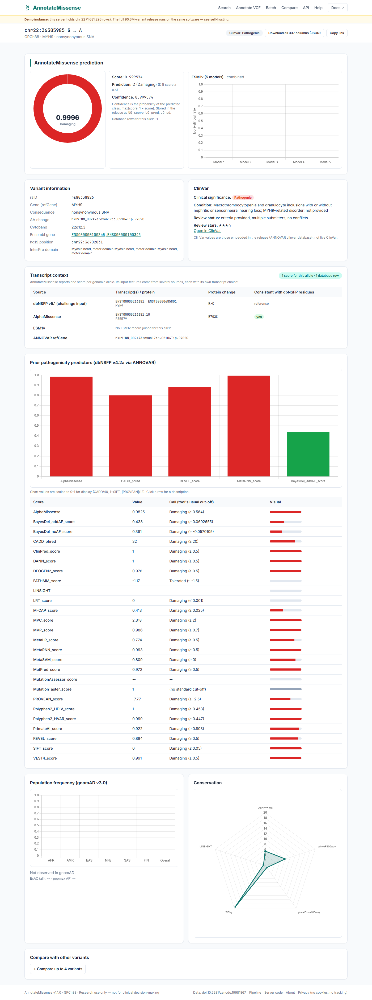

# AnnotateMissense

**Precomputed pathogenicity scores and 337 annotations for 90,643,830 GRCh38 missense variants — searchable on the web, through a REST API, or offline on your own VCFs.**

AnnotateMissense integrates ANNOVAR gene/region/filter annotations, dbNSFP transcript and protein context, AlphaMissense, ESM1v, conservation, population frequency and 30+ prior predictors, and scores every allele of the CAGI7 Annotate-All-Missense input (dbNSFP v5.1 nonsynonymous SNVs) with an XGBoost classifier. The ClinVar benchmark gave a mean five-fold MCC of 0.9411 (ROC-AUC 0.9950). Temporal validation on 298,353 newer ClinVar variants gave MCC 0.7613.

{ width="100%" }

## What you can do

| I want to… | Use | Needs |
|---|---|---|
| Check one variant or a short list | [Web server](server.md) | a browser |
| Annotate my VCF and get a VCF back | [Annotate VCF page or API](vcf.md), or the [offline CLI](cli.md) | browser / `curl` / Python ≥ 3.10 |
| Query programmatically from Python, R or a pipeline | [REST API](api.md) | `curl` or any HTTP client |
| Run genome-wide queries or join with my own tables | [DuckDB database](database.md) | 20.8 GB download, DuckDB ≥ 1.4.3 |
| Host my own server (e.g. for clinical-research data that cannot leave the institution) | [Self-hosting](server.md#self-hosting) | Python or Docker, the database |
| Reproduce the annotation, training and inference | [Research pipeline](pipeline.md) | HPC, ANNOVAR, ~1 TB |

!!! warning "Lookup, not de novo prediction"
    AnnotateMissense returns the score that was **precomputed** for a GRCh38 single-nucleotide allele in the release. User VCFs *are* supported: each ALT allele is matched against the release. Nothing is re-predicted. Indels, MNVs and non-coding alleles get an explicit status (`not_snv`, `not_in_release`) and no score. Because the release enumerates every possible nonsynonymous SNV in dbNSFP v5.1, almost any coding SNV that is missense in at least one transcript is covered. Scoring alleles outside the release would require re-running the [research pipeline](pipeline.md); the trained genome-wide model is not part of the v1.0.0 deposit.

## Answers at a glance

| Question | Short answer | Details |
|---|---|---|
| Can it score my VCF? | Yes, by lookup. Upload in the browser (≤10,000 ALT alleles), `POST /api/v1/annotate`, or run `annotatemissense annotate-vcf` offline with no size limit. Output is your VCF plus `AnnotateMissense_score/_pred/_status` INFO fields. | [VCF](vcf.md) |
| What do I install? | Nothing to use the web server. Local use: Python ≥ 3.10 + `duckdb` (+ Flask for the server). No ANNOVAR, GPU or dbNSFP download. | [Requirements](requirements.md) |
| Hardware / storage / runtime? | Local lookup: 20.8 GB download, ≈50–55 GB extracted (estimated), any laptop. Measured: ~0.1 s per API lookup, ~11 s per 100,000 VCF alleles. The genome-wide rebuild is an HPC job: ~1 TB intermediate storage, up to 128 GB RAM per job, days of compute. | [Requirements](requirements.md) |
| How big is the database, and what's in it? | `variants.duckdb.gz`: 20,819,921,303 bytes. One table, `variants`, with 337 columns (allele key, ANNOVAR, dbNSFP v4.2a/c, gnomAD, ClinVar, AlphaMissense, ESM1v, AnnotateMissense prediction). | [Database](database.md) |
| How are transcripts handled? | One AnnotateMissense score per genomic allele. Features come from several sources, each with its own transcript (all overlapping dbNSFP transcripts; one AlphaMissense transcript; ESM1v GENCODE v43 proteins). Duplicate rows for an allele never carry different scores. | [Transcripts](transcripts.md) |
| Licence? | The Zenodo deposit is CC BY 4.0, but it embeds third-party values with their own terms. Some are academic/non-commercial only (e.g. CADD, PolyPhen-2, REVEL, VEST4). ANNOVAR needs registration only to rebuild. | [Licensing](licensing.md) |
| Why are there different names? | *AnnotateMissense* is the tool. `UQ_score`/`UQ_pred` and `UQ_BioSig_model_Final.tsv.gz` are historical names for its score and prediction table. | [Naming](naming.md) |

## Components

- **Pipeline and documentation:** [github.com/MuhammadMuneeb007/AnnotateMissense](https://github.com/MuhammadMuneeb007/AnnotateMissense)
- **Server, API and CLI:** [github.com/MuhammadMuneeb007/AnnotateMissense-Server](https://github.com/MuhammadMuneeb007/AnnotateMissense-Server)
- **Data release (v1.0.0):** [doi:10.5281/zenodo.19981867](https://doi.org/10.5281/zenodo.19981867), files `variants.duckdb.gz` (20.8 GB) and `UQ_BioSig_model_Final.tsv.gz` (1.4 GB)

## Citation

Muneeb M, Ascher DB. *AnnotateMissense: a genome-wide annotation and benchmarking framework for missense pathogenicity prediction.* Data: doi:10.5281/zenodo.19981867.

!!! note "Intended use"
    Scores support research prioritisation, benchmarking and variant triage. They are not clinical classifications. Clinical interpretation needs expert review that integrates disease context, inheritance, segregation, functional evidence and ACMG/AMP guidance.
