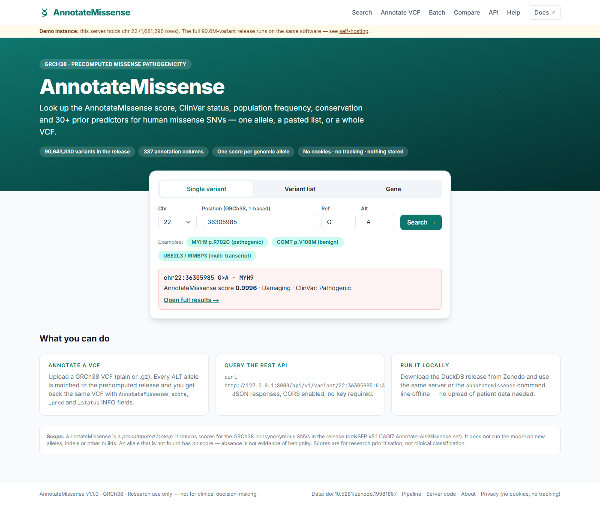
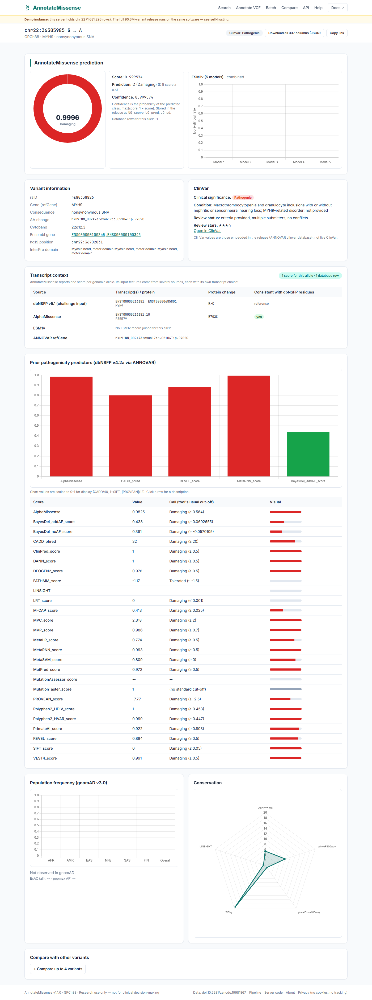
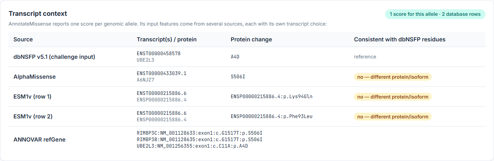
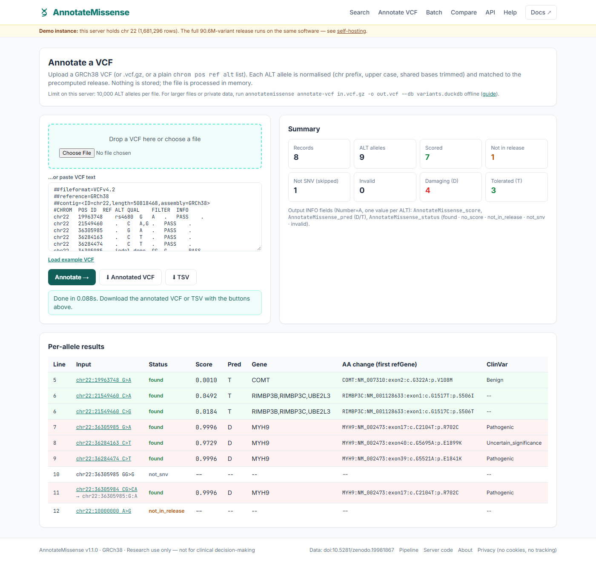
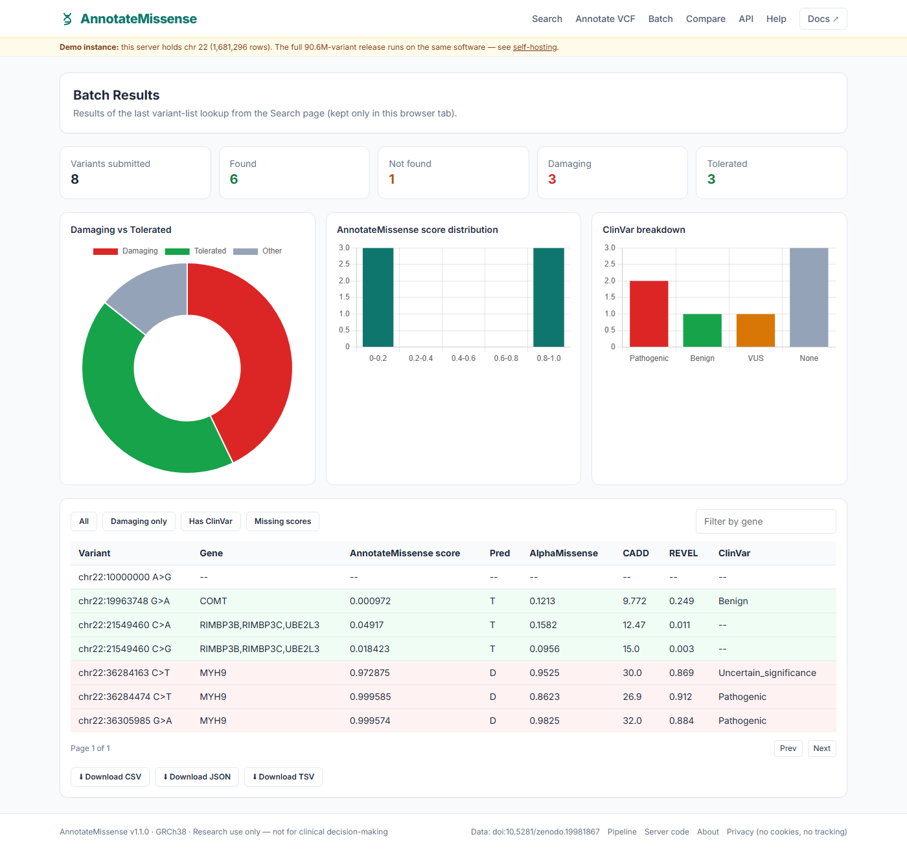
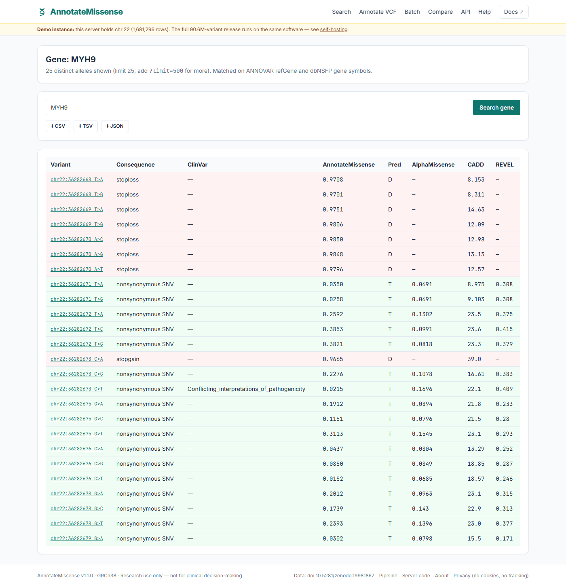
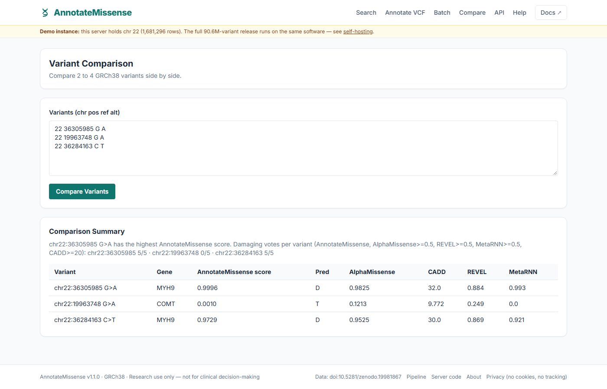

# Web server

The AnnotateMissense server is a Flask application ([source](https://github.com/MuhammadMuneeb007/AnnotateMissense-Server)) that serves the released DuckDB database through a web interface and a [REST API](api.md). It sets no cookies, runs no analytics and stores no submitted data.

!!! info "Public instance"
    A demonstration instance serving the chromosome-22 extract of the release (1,681,296 rows, all 337 columns) is available at
    **<https://lobby-dsc-superintendent-classics.trycloudflare.com>**.
    It runs on the authors' workstation through a Cloudflare tunnel, so the address may change and availability is not guaranteed. The software is identical for the full genome-wide database; [self-host](#self-hosting) it for genome-wide or high-volume use.

## Search

Enter chromosome, GRCh38 position, reference and alternate allele, or click an example. The inline result links to the full report. The other two tabs take a pasted variant list (up to 1,000 alleles) or a gene symbol.



## Variant report

`/results?chr=22&pos=36305985&ref=G&alt=A` shows:

- **AnnotateMissense prediction:** the score (0–1), the prediction (D if ≥ 0.5, otherwise T) and the confidence, which is the probability of the predicted class.
- **Variant information:** rsID, refGene consequence and amino-acid change, cytoband, Ensembl gene, hg19 position, InterPro domain.
- **ClinVar:** significance, condition and review status as embedded in the release.
- **Transcript context:** which transcript and protein each source used (see [Transcripts](transcripts.md)).
- **Prior predictors:** 28 dbNSFP v4.2a scores, each called against the tool's documented cut-off, which is shown next to the call.
- **gnomAD v3.0 frequencies and conservation scores.**
- **Download all 337 columns** as JSON.



For an allele in overlapping genes (UBE2L3 / RIMBP3B / RIMBP3C), the transcript panel shows that the sources annotate different proteins, while the allele still has one score:



## Annotate a VCF

`/annotate` takes a VCF (plain or gzip), or pasted text, and returns a per-allele table plus downloadable annotated VCF and TSV files. See [Annotating a VCF](vcf.md).



## Batch results, gene view and comparison







## Self-hosting

=== "Python"

    ```bash
    git clone https://github.com/MuhammadMuneeb007/AnnotateMissense-Server
    cd AnnotateMissense-Server
    python -m venv .venv && source .venv/bin/activate     # Windows: .venv\Scripts\activate
    pip install -r requirements.txt && pip install -e .

    curl -L -o data/variants.duckdb.gz "https://zenodo.org/records/19981867/files/variants.duckdb.gz?download=1"
    gzip -d data/variants.duckdb.gz

    annotatemissense serve --db data/variants.duckdb --host 0.0.0.0 --port 8000
    ```

=== "Docker"

    ```bash
    git clone https://github.com/MuhammadMuneeb007/AnnotateMissense-Server
    cd AnnotateMissense-Server
    # place variants.duckdb in ./data
    docker compose up -d --build          # nginx + gunicorn on http://localhost:8080
    ```

=== "Scores only (1.4 GB)"

    ```bash
    curl -L -o UQ_BioSig_model_Final.tsv.gz "https://zenodo.org/records/19981867/files/UQ_BioSig_model_Final.tsv.gz?download=1"
    annotatemissense build-score-index UQ_BioSig_model_Final.tsv.gz -o data/annotatemissense_scores.duckdb
    annotatemissense serve --scores data/annotatemissense_scores.duckdb
    ```
    This index answers score lookups and VCF annotation, but not the gene view or the full annotation report.
    `pred = U` rows ("No prediction available") are stored with no score, not a score of 0, and exact duplicate rows are collapsed.

Both resources can be loaded together (`--db` and `--scores`). The score then comes from the index and the annotations from the database.

| Environment variable | Default | Meaning |
|---|---|---|
| `ANNOTATEMISSENSE_DB` | `data/variants.duckdb`, then `data/variants_dev.duckdb` | annotation database |
| `ANNOTATEMISSENSE_SCORES` | `data/annotatemissense_scores.duckdb` if present | score index |
| `MAX_BATCH_VARIANTS` | 1000 | batch endpoint limit |
| `MAX_VCF_ALLELES` | 10000 | ALT alleles per VCF upload |
| `MAX_UPLOAD_MB` | 50 | maximum request size |
| `RATE_LIMIT` | `300/hour` | per-IP API rate limit |
| `TRUST_PROXY` | 0 | set to 1 behind nginx or Cloudflare so rate limits see client IPs |

### Exposing a server publicly

The demonstration instance was published with a Cloudflare quick tunnel, which needs no account:

```bash
TRUST_PROXY=1 annotatemissense serve --db data/variants.duckdb --port 8000 &
cloudflared tunnel --url http://127.0.0.1:8000      # prints a https://<random>.trycloudflare.com address
```

For a permanent service, run the Docker setup on a host with a fixed DNS name and TLS, or use a named Cloudflare tunnel.
