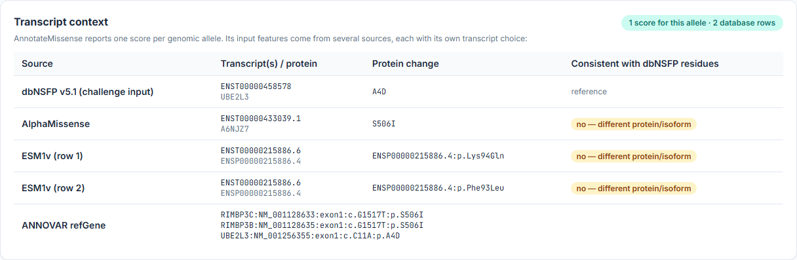

# Transcripts and alleles

**Summary:** AnnotateMissense reports **one score per genomic allele** (GRCh38 chromosome, position, reference, alternate). The model is not run per transcript. Its input features come from several resources, and each resource made its own transcript choice, as described below. There is no single canonical-transcript rule such as MANE Select across all features.

The numbers on this page come from a full audit of the chromosome-22 extract of the released database (1,681,296 rows). The audit can be reproduced on the full file with `annotatemissense audit --db variants.duckdb` and the queries below.

## One score per allele

| Measure (chromosome 22) | Value |
|---|---:|
| Database rows | 1,681,296 |
| Distinct genomic alleles | 1,664,217 |
| Alleles with more than one row | 16,718 (1.0%) |
| Maximum rows per allele | 4 |
| **Alleles whose rows carry different AnnotateMissense scores** | **0** |

Duplicate rows have two causes, and no other column ever differs within an allele:

- **11,738 alleles (70%)**: exact duplicate rows, identical in all 337 columns.
- **4,980 alleles (30%)**: rows that differ only in ESM1v columns (`esm1v_*`, `combined_score`, `HGVS.p`, `GENCODE.v43.*`), where the ESM1v table matched more than one protein record.

The genome-wide prediction table (`UQ_BioSig_model_Final.tsv.gz`) is keyed the same way. In its first 149,574 rows, 3,915 alleles appear twice, always with identical score and prediction. The server, API and CLI therefore return **one record per allele**, plus `annotation_rows` so you can see when an allele had several database rows.

## Where each feature's transcript comes from

| Source | Transcript/protein representation in the release | Coverage (chr22) | Agreement with the allele |
|---|---|---|---|
| **dbNSFP v5.1** (challenge input: `genename`, `aaref`, `aaalt`, `aapos`, `Ensembl_transcriptid`, `Ensembl_proteinid`) | all Ensembl transcripts in which the allele is nonsynonymous, `;`-separated | 100% of rows; 69.0% list more than one transcript | defines the reference amino-acid change |
| **ANNOVAR gene-based** (`*.refGene`, `*.ensGene`, `*.knownGene`, `*.ccdsGene`) | `AAChange.*` lists every transcript of every overlapping gene; `ExonicFunc.*` is ANNOVAR's most severe consequence | all rows | per transcript, as reported by ANNOVAR |
| **dbNSFP v4.2a/c predictors** (SIFT, PolyPhen-2, REVEL, CADD, MetaRNN, …) | one value per field and allele, as distributed in ANNOVAR's `dbnsfp42a`/`dbnsfp42c` databases (transcript-specific scores are not kept per transcript) | varies by tool | allele-level |
| **AlphaMissense** (`am_pathogenicity`, `transcript_id`, `protein_variant`) | one transcript per allele (AlphaMissense hg38 predictions for canonical transcripts) | 85.8% of rows | its transcript is among the dbNSFP transcripts in 96.8% of rows; amino-acid change matches dbNSFP in 99.0% |
| **ESM1v** (`esm1v_t33_650M_UR90S_1…5`, `HGVS.p`, `GENCODE.v43.ENST/ENSP`) | GENCODE v43 protein records joined to the allele; may be several per allele | 25.4% of rows | its transcript is among the dbNSFP transcripts in 2.2% of rows; amino-acid change matches dbNSFP in 3.0% |

!!! warning "ESM1v columns are not reliably allele-matched"
    In the released database, the ESM1v protein change (`HGVS.p`) usually describes a different residue or protein from the allele's dbNSFP amino-acid change. For example, chr22:21549460 C>A (UBE2L3 p.A4D) carries ESM1v records `p.Lys94Gln` and `p.Phe93Leu`. Treat the ESM1v columns as provisional. The manuscript's ablation found that removing AlphaMissense and ESM-derived features changed benchmark MCC only from 0.9411 to 0.9409 (Dataset 7).

## Overlapping genes: an example

chr22:21549460 C>A lies in UBE2L3 and in the overlapping RIMBP3B/RIMBP3C. The sources annotate different proteins, but the allele has one AnnotateMissense score (0.04917):



| Source | Transcript / protein | Protein change |
|---|---|---|
| dbNSFP v5.1 | ENST00000458578 (UBE2L3) | A4D |
| AlphaMissense | ENST00000433039.1 (A6NJZ7, RIMBP3C) | S506I |
| ESM1v | ENST00000215886.6 / ENSP00000215886.4 | p.Lys94Gln; p.Phe93Leu (two rows) |
| ANNOVAR refGene | RIMBP3C NM_001128633, RIMBP3B NM_001128635, UBE2L3 NM_001256355 | p.S506I, p.S506I, p.A4D |

The web report and `GET /api/v1/variant/...` show this breakdown for every allele (`transcripts` block, with `matches_dbnsfp_amino_acids` flags).

## Interpreting scores for a specific isoform

Because the score is allele-level, it does not distinguish isoforms. If the clinically relevant transcript is not among the dbNSFP transcripts listed for the allele, or AlphaMissense annotates a different gene (as in the overlapping-gene example above), interpret the score cautiously and look at the transcript-specific fields (`AAChange.refGene`, `aapos`).

## Reproduce the audit

```sql
-- allele multiplicity and score concordance
WITH g AS (SELECT Chr, Start, Ref, Alt, COUNT(*) AS n, COUNT(DISTINCT UQ_score) AS k
           FROM variants GROUP BY ALL)
SELECT SUM(n) AS rows, COUNT(*) AS alleles, SUM((n > 1)::INT) AS multi_row_alleles,
       MAX(n) AS max_rows, SUM((k > 1)::INT) AS discordant_score_alleles
FROM g;

-- AlphaMissense agreement with the dbNSFP amino-acid change
SELECT COUNT(*) AS rows_with_am,
       SUM((left(protein_variant, 1) = aaref AND right(protein_variant, 1) = aaalt)::INT) AS aa_match,
       SUM(list_contains(string_split(Ensembl_transcriptid, ';'), split_part(transcript_id, '.', 1))::INT) AS tx_in_dbnsfp
FROM variants WHERE transcript_id IS NOT NULL;
```
